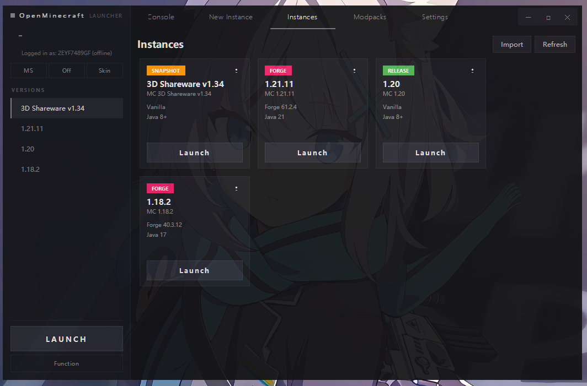

# Open Minecraft launcher

A modern Minecraft launcher with a **built-in peer-to-peer (WebRTC) network tunnel**, a clean flat dark UI, plugin support, an in-game auto-clicker, memory tools, mod & modpack handling and more.

> **OpenMCL is an independent launcher for Minecraft.** It is not affiliated with Mojang or Microsoft.

---

## 🚀 Highlights

- **Built-in P2P networking** — no public relay, no drivers, no third-party VPN tools. A server machine can forward *any* TCP service through a peer-to-peer WebRTC DataChannel.
- **One-code connection** — the server generates a short self-contained code (IP + port + token baked in); clients just paste it to connect. Multiple clients are connected and managed individually.
- **Complete instance manager** — download Minecraft, create / import / launch instances, per-version Java & JVM settings.
- **Loader support** — Forge, Fabric, NeoForge and Quilt.
- **Mod & modpack downloader** — backed by aria2 multi-connection downloads (auto-bootstrapped when missing).
- **Tools** — in-game Auto Clicker, Minecraft Server manager, Memory viewer/editor, Minimap, Skin Station login.
- **Plugin system** — drop Python plugins (a `plugin.py`/`main.py` entry folder) into `ui/plugins` and run them.
- **i18n** — English & Chinese locales.
- **Flat dark UI** — frameless window, adjustable opacity, consistent sharp corners.

---

## ✨ Full Feature List

### 📦 Launcher core

| Feature | Description |
|---|---|
| **Minecraft download** | Install any Minecraft release by version (via managed mirrors). |
| **Version chain** | Server manifest → version json → assets/libraries auto-resolution. |
| **New Instance** | Create standalone instances from a MC version. |
| **Instances** | Launch, per-instance Java + JVM args, settings, reinstall, remove. |
| **Import** | Import an existing `.minecraft` folder or a modpack `.zip` archive. |
| **Mod loaders** | Install & manage **Forge / Fabric / NeoForge / Quilt**. |
| **Modpacks** | Download, install and run modpack distributions. |
| **Launch engine** | Java detection, per-instance Java, JVM arguments, windowed/fullscreen, resolution, custom Minecraft directory. |
| **Console** | Real-time live game console output inside the launcher. |

### 🔑 Accounts

- **Microsoft** login (device-code flow) — real Mojang/Microsoft account.
- **Offline** login (cracked/single-player profile).
- **Skin Station** login (third-party skin platform).

### 🌐 Multiplayer Helper (Built-in P2P Tunnel)

Replaces the old L2TP/VPN approach with a **WebRTC-based peer-to-peer tunnel** that runs in pure user space (no wintun / kernel driver).

- **Server side** — start the service, auto-detect your local IP, generate a short self-contained **connection code**.
- **Client side** — paste the code → connect. Any TCP service exposed by the server becomes reachable on your local port.
- **Multi-client** — every client gets its own tunnel instance; view the connection list, and disconnect anyone at any time.
- How it works: a single WebRTC `DataChannel` multiplexes many TCP streams (8-byte header = connection id + payload length), giving TCP-over-DataChannel forwarding with STUN-backed NAT traversal.

> **NAT notice:** works out of the box on standard connection-friendly NATs. Under restrictive/symmetric NAT (e.g. carrier CG-NAT) hole-punching may fail and a **TURN relay** is needed. The server also needs a reachable entry (public IP or port forwarding) for the handshake.

### 🎮 Tools

| Tool | Description |
|---|---|
| **Auto Clicker** | Configurable left/right auto-clicker with hotkey recording, adjustable interval, and a **Minecraft-foreground guard** (only fires while the game is active). |
| **Server manager** | Download official Minecraft Server JARs and manage dedicated servers. |
| **Memory Viewer** | Read/write process memory on a running instance, list memory regions, scan regions, hex dump, optional auto-refresh. |
| **Macro engine** | Low-level hotkey polling + click injection for the game window. |

### 🧩 Plugin System

- Load shared-package / EXEC plugins from the **Plugins** page (**Open Plugin Folder**, **Run Plugin**, **Run Selected**).
- Plugins may **inject buttons into the launcher home** via `plugin_api`.
- See [`ui/plugins/PLUGIN_DEV.md`](ui/plugins/PLUGIN_DEV.md) and the bundled demo plugins.

### ⚙️ Settings

- **Account** display.
- **Opacity** — window transparency slider.
- **Language** — English / Chinese.
- **Java** — default Java, auto **Detect**, manual **Browse**.
- **Download** — mirror selection (**FastMinecraftMirror / BMCLAPI / Mojang Official**) and **aria2 threads** count.
- **Memory** — max & min RAM (Java allocation).
- **Window** — windowed/fullscreen mode + resolution presets.
- **JVM args** — extra global fallback JVM arguments.
- **Directory** — custom `.minecraft` / data directory.

---

## 📸 Screenshots



---

## 🖥 Requirements (run from source)

- Windows
- Python 3.10+
- Java (auto-detected or configured per instance)

Install dependencies:

```bash
pip install -r requirements.txt
```

```text
PyQt5>=5.15.0
numpy>=1.24.0
requests>=2.28.0
aiortc>=1.9.0
```

## ▶️ Run

```bash
python main.py
```

---

## 📁 Project layout

```
OpenMCL/
├─ main.py                  # entry point (PyQt5, flat dark theme)
├─ core/
│  ├─ p2p_link.py           # WebRTC P2P tunnel (client/server, code-based)
│  ├─ launcher.py           # game launch engine
│  ├─ version_manager.py    # MC versions, mirrors, manifests
│  ├─ downloader.py         # asset / jar / mod downloads
│  ├─ aria2_manager.py      # aria2 multi-connection front-end
│  ├─ modloader_manager.py  # Forge / Fabric / NeoForge / Quilt
│  ├─ java_manager.py       # Java discovery
│  ├─ instance_importer.py  # import .minecraft / modpack archives
│  ├─ macro_engine.py       # hotkeys + click injection
│  ├─ memory_api.py         # unified process memory access
│  ├─ stealth_memory.py     # low-level memory read/write
│  ├─ process_isolation.py  # isolated process helper
│  ├─ minimap.py            # minimap data(not used)
│  ├─ vpn_manager.py        # (legacy) VPN module entry
│  └─ auth.py               # account manager
├─ ui/                      # widgets, dialogs, panels
│  ├─ p2p_widget.py         # P2P client/server panel
│  ├─ function_widget.py    # Tools: Macro / Multiplayer / Server / Plugins
│  ├─ minimap_widget.py     # OpenGL minimap(not used)
│  ├─ plugins/              # plugin system + demos
│  └─ ...
├─ i18n/                    # en / zh locales
└─ scripts/                 # dev tests (P2P self-test)
```

## 🔨 Build (PyInstaller)

A PyInstaller spec is included. It builds a **folder distribution** (not a single file):

```bash
pip install pyinstaller
pyinstaller OpenMCL.spec
```

Output lands in `dist/OpenMCL/`. Variable resources (`plugins`, `java`, `aria2`, `i18n`) are resolved from the same folder as the exe, so they can be extended/upgraded without rebuilding.

## 📜 License

Released into the **public domain** under [The Unlicense](LICENSE):

```
This is free and unencumbered software released into the public domain.

THE SOFTWARE IS PROVIDED "AS IS", WITHOUT WARRANTY OF ANY KIND, EXPRESS OR
IMPLIED, INCLUDING BUT NOT LIMITED TO THE WARRANTIES OF MERCHANTABILITY,
FITNESS FOR A PARTICULAR PURPOSE AND NONINFRINGEMENT.
```

Copy, modify, publish, sell — for any purpose, commercial or non-commercial.

---

*Please do not distribute modified builds that misrepresent themselves as official Mojang/Minecraft software.*
